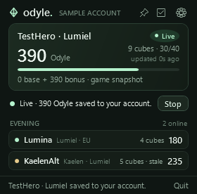
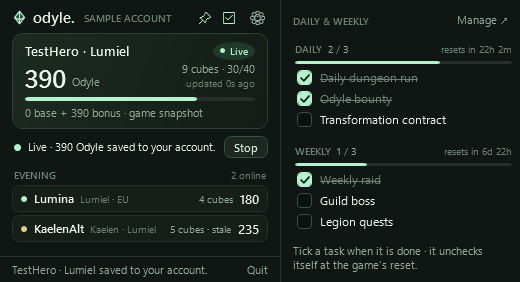
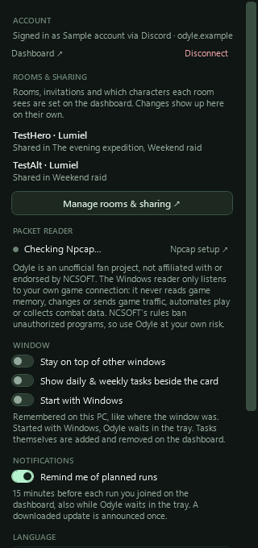

# Odyle Windows Companion

A .NET 10 WPF tray app for your **Discord-linked Odyle account**, persistent characters and private PocketBase rooms. The dashboard and backend are in [odyle-dashboard](https://github.com/oldbear24/odyle-dashboard). The app speaks **English and Czech**.

## Use it

1. Start/configure the dashboard's backend and sign in on the web with Discord.
2. Download the newest release: **My rooms & characters** links it as **Windows app &lt;version&gt;**, and the **Pair Windows app** dialog offers the packages (see [Download and updates](#download-and-updates)). The simplest is the installer `odyle-<version>-win-x64-setup.exe`: it needs no administrator rights. Alternatively extract a ZIP into a folder you can write to and run `Odyle.exe`. Either way the app updates itself from then on.
3. On **My rooms & characters**, choose **Pair Windows app**, then **Copy connection link**.
4. Open **Settings** (⚙) and click **Paste link & connect**. Settings opens by itself whenever Odyle starts without a connection to your account: unpaired, or (unless it started with Windows) while a saved pairing is still being retried. The link includes the server address and a one-use code that expires after five minutes. You pair once: the app then stays connected across restarts, updates and weeks switched off, until you choose **Disconnect**, remove the PC on the dashboard or choose **Sign out everywhere** there. You can also paste it into the input and press Enter. An older code-only connection works through the collapsed **Server address** option.
5. Install [Npcap](https://npcap.com/#download) from its official site with its default options; Odyle may not bundle it. The installer checks for Npcap and, when it is missing, shows a page and a last-page checkbox that open the download page. Odyle checks again at every start and whenever the reader cannot start: the reader line then says **Npcap is not installed** with an **Install Npcap ↗** link, Odyle looks for Npcap every 10 seconds and starts reading by itself once it is there, without a restart. An Npcap installed with **Restrict Npcap driver's access to Administrators only** shows Odyle no network interface; the reader line and **Settings → Packet reader** say so, and reinstalling Npcap without that option fixes it. The reader starts by itself once the app is connected to your account (**Stop**/**Start** beside the reader status toggles it). Keep Odyle running before logging your character into the game when you can: the login snapshot names the character at once. Started later, the app reads the total at the next Odyle change, and the game names the character within a few minutes (it repeats its own-character message irregularly: in the author's log half the repeats came within about 90 seconds, a quarter only after more than four minutes and the longest after about 45 minutes) or at once after a relog or channel change. Odyle restarting itself (an update or a language change) is not such a late start: the character it was reading is handed to the new start and stays live without a relog. The character always comes from the game: its own-character message provides the name, server and Global region, and the app saves and shows that character automatically, following any in-game switch. There is no character picker or manual character entry; a character on a server the app cannot map yet is shown but not saved. A character the game shows without Odyle (it is said to unlock at level 22) is labelled **No Odyle on &lt;name&gt; yet** until its first reading.
6. Rooms and sharing are set on the dashboard: under **My rooms & characters → Room sharing**, switch on each room that should see each character (**Manage rooms & sharing ↗** in Settings opens it). Sharing is per character: a new character starts private. Create and join rooms there too. The app picks up changes by itself. Values remain saved when you leave a room or sign out.

The app remembers your connection using Windows DPAPI, never Discord passwords or OAuth tokens. Pairing gives this PC its own device key; the app trades it for a fresh seven-day account token whenever it starts, once a day while it runs and whenever the server turns a token down, so the pairing never runs out on its own. Pairing and every sign-in send the PC's Windows computer name (at most 40 characters), so the dashboard's **Account & data** lists your paired PCs by name and lets you remove one; a removed PC notices within about a minute and asks for a new connection link. **Disconnect** forgets the device key on this PC and on the server. Only when the server no longer knows the key (Disconnect, PC removed, **Sign out everywhere**, account deleted) does the app ask for a new link; a `session.bin` that this Windows account cannot read counts as not paired too, with a message saying so. An app paired before device keys existed receives its key the next time it connects to an updated backend. Hosted connections require HTTPS; HTTP is allowed only on localhost.

**When the server is unavailable** the pairing is kept and the app tries again by itself: after 15 seconds, 30 seconds, 1 minute, 2 minutes and then every 5 minutes, counting down to the next try in the footer; **Reconnect saved account** (Settings → Server address) tries at once. A server that asks the app to slow down (429) pauses all requests for its `Retry-After` (a minute without one) and the footer shows **Server busy · retrying in …**; the reading stays live and the reader session is kept. While the app runs, a connection lost to the server is restored with the next 20-second heartbeat.

The main window is a compact 280 px card with a dark title bar and its own icon: the character the game reports, its current Odyle, reward cubes at the cost of the first room it is shared in, a Live / Stale / Saved state, the reader status and **Start/Stop reader**. Below it, the party list shows, under a header per room with how many are online, the other members' characters that room can see while their readers report them: Odyle, cubes at that room's cost, and an amber dot once a reading has gone stale (**No one else is online in your rooms.** when nobody is). Offline characters and your own are left out. The list follows the rooms as they change: the app listens to the server's realtime news of your rooms and account, so a mate's reading, heartbeat or sharing change shows up within seconds, and it reads the rooms again when that connection comes back and every five minutes in case news was missed. Without realtime (a proxy that buffers it) the list refreshes every 15 seconds while the window is open, as before. The separate **Settings** window (⚙ or the tray menu) holds only what belongs to this PC: pairing and server address, account and disconnect, a read-only summary of where each character is shared, the Npcap check with the scope notice below, how the window is shown (stay on top, checklist beside the card, start with Windows), notifications, the language, the installed version with its updates, and troubleshooting (the log folder and **Copy diagnostics**). Everything else is configured on the dashboard. Closing either window keeps the app in the tray; starting Odyle again while it runs brings its window forward.

**Stay on top and your checklist.** The pin in the header keeps the window above other windows, for example the game in windowed or borderless mode; the tray menu and **Settings → Window** toggle the same. The checklist button beside it opens a panel to the right of the card with your **Daily & weekly** tasks from the dashboard: each list shows how many are done, a progress bar and a countdown to its reset (the Global service resets daily at 07:00 UTC and weekly on Wednesday; the backend's settings decide, and the header tooltip shows the reset in your local time). Tick a task when it is done; the server stores the time and the task unchecks itself at the reset. Tasks are added, renamed and removed on the dashboard (**Manage ↗**), and the panel follows those changes as they happen (every 15 seconds without realtime). When the window grows it is kept on its screen. The window reopens where you left it, as long as that spot is still on a connected screen; otherwise it opens centred.

**Start with Windows.** **Settings → Window → Start with Windows** adds the per-user entry `HKCU\Software\Microsoft\Windows\CurrentVersion\Run` → `Odyle` = `"<path>\Odyle.exe" --tray` (the installer offers the same). Started that way, Odyle waits in the tray: a paired app does not open any window, also while it is still retrying an unavailable server, and an unpaired one opens the window and settings as usual. After the first live reading, while it is off, the card offers it once (**Start with Windows** or **No thanks**), since a reader running before you log in names the character at once; the answer is remembered on this PC, and Settings changes it at any time.

**Notifications.** With **Settings → Notifications → Remind me of planned runs** (on by default), Odyle shows a Windows notification 15 minutes before each planned run you joined on the dashboard, with the dungeon, the room, the local start time and the note; each run is announced once per start time, so a run moved to another time is announced again. Odyle keeps following the rooms while it waits in the tray (without realtime it reads them every minute), so reminders work without the window. A downloaded update is announced once per version. Clicking a notification opens the window.

**Language.** Odyle follows the Windows display language: Czech on a Czech Windows, English otherwise. **Settings → Language** chooses Automatic, English or Čeština; the choice applies when Odyle restarts (Settings offers **Restart now**). Numbers, dates and times follow the chosen language, and the server's English messages are shown in Czech too, in the dashboard's wording.

**Announcements.** When the server's operators post a message (planned maintenance, an update to install), it appears above the reading card the next time the app reads the rooms (within 15 seconds without realtime, within five minutes with it), amber for warnings. ✕ hides it until the message changes.

**Paused by the server.** The operators can pause every packet reader at once (the dashboard's superuser **Server controls → Pause packet readers**), for example while a game patch is checked. The app learns it from the rooms, session and heartbeat answers, so within about 20 seconds, or from a reading the server refuses for it: it stops capturing and closes Npcap, the pill says **Paused** and the card **Paused by the server**, with the operators' announcement when there is one (it moves from above the card into it meanwhile), and **Start** stays off. When the operators switch the pause off, the reader starts again by itself, unless you had stopped it.

All of these choices (window, position, language, notifications, whether the Start with Windows offer was answered) are remembered on this PC in `%LOCALAPPDATA%\Odyle\preferences.json`; nothing about them is sent to the server.

**Log.** For troubleshooting, Odyle keeps a small log in `%LOCALAPPDATA%\Odyle\logs\odyle.log` (about 1 MB, plus the previous file as `odyle.previous.log`): start-up, connection and reader changes, errors, update actions and the decoder's diagnostics for Odyle updates, stat snapshots, frame layouts and the own-character message. It never contains account tokens, device keys or pairing codes. **Settings → Troubleshooting → Open log folder** opens it. **Copy diagnostics** beside it puts a short report on the clipboard for a bug report: the app version and package, Windows and the language, the Npcap check and version, the capture interfaces by name, whether the app is paired (the server's host only), the reader's state and its last ten status lines, and the last 80 log lines. The report masks the account id, this PC's name and the Windows user folder besides what the log never holds; character names and the server's host stay in, and nothing is sent anywhere until you paste it. An unexpected error is logged and the app keeps running with a short note.

**Scope.** Odyle is an unofficial fan project, not affiliated with or endorsed by NCSOFT. The Windows reader only listens to your own game connection: it never reads game memory, changes or sends game traffic, automates play or collects combat data. NCSOFT's rules ban unauthorized programs, so use Odyle at your own risk. The installer's welcome page and **Settings → Packet reader** say the same, in English and Czech.







## Download and updates

Every push to `main` that changes more than documentation publishes a [GitHub release](https://github.com/oldbear24/odyle-windows/releases/latest); the dashboard links the newest one on **My rooms & characters** and in its **Pair Windows app** dialog (its backend reads the release list from GitHub for it).

| Package | Approximate size | Requirements |
| --- | --- | --- |
| `odyle-<version>-win-x64-setup.exe` | 60 MB | Windows x64 (also Windows 11 on ARM through x64 emulation). Installs the self-contained build for the current user into `%LOCALAPPDATA%\Programs\Odyle`, no administrator rights |
| `odyle-<version>-win-x64.zip` | 300 KB | [.NET 10 Desktop Runtime](https://dotnet.microsoft.com/en-us/download/dotnet/10.0) for Windows x64 |
| `odyle-<version>-win-x64-self-contained.zip` | 68 MB | Bundles its runtime |
| `odyle-<version>-win-arm64.zip` | 300 KB | .NET 10 Desktop Runtime for Windows Arm64 |
| `odyle-<version>-win-arm64-self-contained.zip` | 63 MB | Windows on ARM, bundles its runtime |

Every file has a `.sha256` beside it. The installer shows the scope notice on its welcome page, checks for Npcap (its `HKLM\SOFTWARE\Npcap` key in both registry views) and links to its download page when it is missing, adds a Start-menu shortcut and, if you choose, a desktop shortcut and **Start with Windows**; it is offered in English and Czech. Uninstalling (Settings → Apps) removes the program, its downloaded updates and the Start with Windows entry. While the PC is paired it asks whether to disconnect it from your account too: **Yes** runs `Odyle.exe --unpair`, which closes a running Odyle, forgets the device key on the server and deletes the saved pairing, like **Disconnect** (offline, only this PC forgets it; remove the PC on the dashboard then). **No**, and a silent uninstall, keep the pairing and preferences in `%LOCALAPPDATA%\Odyle` for a later install. Windows keeps the uninstaller of the setup that installed Odyle, and the app's own updates replace only the program files: an install made with an earlier setup and updated since then does not ask, so use **Settings → Disconnect** before uninstalling it (or run the current setup over it once). For a ZIP, extract it into a folder you can write to (your own folder, not Program Files) and run `Odyle.exe`. The small download uses the installed runtime; Microsoft shows the required runtime download dialog if it is missing. Choose **Desktop Runtime**, which includes WPF support. Use a standalone package if you prefer no runtime installation. Sizes refer to this build and may change slightly.

**The app updates itself.** A released build (version `<Version>.<run number>`, for example 0.6.0.12) checks this repository's GitHub releases a few seconds after every start and then once a day while it runs; **Settings → Updates** shows the installed version with **Check now** and a link to the releases. When a newer release has a package of the same kind (small or self-contained) for this CPU (x64 or Arm64), the app downloads it to `%LOCALAPPDATA%\Odyle\updates\<version>`, verifies the ZIP against the release's `.sha256` file, extracts it and checks that the extracted `Odyle.exe` carries that version; the installer is never used for updates, and an installed app updates from the self-contained x64 ZIP like any other. **A release found at start installs right away:** Odyle restarts into the new version by itself, in the tray when it was started there (Start with Windows). While the start check cannot reach GitHub, for example before the network is up after Windows starts, it is tried again after 15 seconds, 30 seconds, 1 minute, 2 minutes and then every 5 minutes, and the first check that gets through still installs at once; a package an earlier start downloaded but could not install is used instead of downloading it again. A release found later by the daily check waits: the footer and Settings offer **Restart to update**, a notification says so once, and left alone it installs by itself the next time Odyle starts. Installing moves the running `Odyle.exe` aside as `Odyle.exe.old` (Windows lets a running program be renamed but not overwritten), copies the new files into the same folder and starts the new version, which deletes the old file. The reader pauses for a moment only: a character that was live is handed to the new version, which sends its last reading again under its own session, so it stays live on the dashboard and your rooms without a relog. After an update that changes the decoder's adapter name the handed-over value keeps the old name; a server that no longer accepts it drops that value, and the new decoder reads the next Odyle change. If the folder is not writable, Settings says so and the release page remains the way to update. Builds are unsigned: the checksum guards against a damaged download, not against a compromised release. Development builds (`dotnet run`, version without a run number) never replace themselves. For updates the app contacts `api.github.com` and `github.com` only, sending a standard request that names the app version; nothing about your account or characters is included.

**Readings come from the game only; manual entry is disabled in both clients and the backend.** While the reader runs, Odyle is sent to your account under the adapter name `global-reference-v2` when a character's value is first read and afterwards only when it changes. A 20-second heartbeat keeps the value live while decodable game packets keep arriving; the dashboard shows it as stale 45 seconds after the heartbeat stops. Each reading is saved to the character the game names: after an in-game character switch the new snapshot waits for the new character's identity, so it never overwrites the previous character. A switch to a character this build cannot name (an unknown class or server) leaves the new character unsaved instead, and after a resync the next reading waits for the game's name too, since the lost packets may have held a switch. Stopping the reader, switching characters, 20 seconds without readable game packets, disconnecting or quitting marks the current reading stale while keeping the last value. If the server refuses a reading, the card shows **Not saved** with the server's message and the app retries a minute later. A backend that does not list the adapter (an older backend, or one whose operators switched this decoder off) makes the app look for its update at once instead of at the daily check: the card says **Odyle needs an update to keep reading**, offers **Restart to update** once the new version is downloaded, and tries the reading again every ten minutes. Close the window to keep it in the tray; **Quit** exits.

**How the reader works.** It passively decodes incoming IPv4/TCP game traffic owned by the local AION2 process using an existing Npcap installation: TCP reassembly, heartbeat synchronization, bounded framing, LZ4 blocks, the own-character message, and the stat snapshot and live stat updates, in which Odyle is the record of resource 60000001. A lost segment or bytes that do not frame resync that connection at the next heartbeat instead of stopping it until a relog; only repeated resyncs (more than five in a minute) stop it with a problem. It captures on every network interface Npcap offers, opens an interface again after it fails, picks up new ones (a VPN or game accelerator, a reset network card) within 30 seconds and restarts after the PC wakes from sleep; it reports a problem only when no interface can capture. When AION2 runs but its game connection does not show up for about a minute, the reader line says why when Windows' connection table shows it: the game connected over IPv6, another program such as an accelerator or proxy holds the connection to the game port, or the game is connected on other ports only. A live EU Global / Lumiel check on Steam build 25800038 read the startup value **0 + 390 = 390**, matching the game display, and the author's decoder log of the following days confirmed the live updates after spends and recharges. Starting the reader **before** logging in is best: the login snapshot names the character and both Odyle components at once. Joining an established connection reads the total from the next live Odyle change; the game names the character within a few minutes, or at once after a relog or channel change. No game memory access, packet injection or gameplay automation is implemented. Npcap is installed separately and is not bundled. See [packet reader details](docs/packet-reader.md).

## Build and package

Windows 10/11 with .NET SDK 10:

```powershell
dotnet build src/Odyle.Reader/Odyle.Reader.csproj -c Release
dotnet run --project src/Odyle.Reader
dotnet run --project tests/Odyle.Core.Checks -c Release
dotnet run --project tests/Odyle.Reader.Checks -c Release
./scripts/publish.ps1
./scripts/publish.ps1 -SelfContained -Installer
./scripts/publish.ps1 -Runtime win-arm64
./scripts/publish.ps1 -Runtime win-arm64 -SelfContained
```

Packaging defaults to the small single-file executable and SHA-256 checksum. `-SelfContained` produces the separate standalone ZIP and stamps `SelfContained` into the assembly metadata, which the updater reads to fetch the same package kind. `-Runtime win-arm64` builds for Windows on ARM. `-Installer` (with `-SelfContained`, x64) also compiles [installer/odyle.iss](installer/odyle.iss) with Inno Setup 6 into `odyle-<version>-win-x64-setup.exe`, installing Inno Setup through Chocolatey when `iscc` is missing. Builds are unsigned. `-Version` stamps a version into the executable and the file names; a build with a four-part version is a release build and updates itself. The Core checks run on any OS; the UI checks and packaging need Windows.

Every push to `main` that changes more than `docs/`, Markdown files or `THIRD-PARTY.md` runs the checks and publishes the GitHub release `v<Version>.<run number>` (for example `v0.6.0.12`) with the installer, the four ZIPs and their checksums, marked as the latest release; installed apps pick it up from there, so keep the package names and the `.sha256` files as they are. `<Version>` comes from `Odyle.Reader.csproj`; bump it to start a new line. Manual runs of the release workflow, other branches and pull requests run the checks and upload every package as workflow artifacts without publishing. **A release that changes the adapter name** (`ExperimentalOdyleDecoder.Version`, now `global-reference-v2`) goes out only after the dashboard backend that accepts the new name is deployed; otherwise every updated app has its readings refused. See [packet reader details](docs/packet-reader.md).

`dotnet run --project tests/Odyle.Reader.Checks -c Release -- --update-probe` downloads the newest release's package for this machine into a temporary folder and verifies it the way the app does (needs the network). `-- --screenshots <folder>` renders the preview images.

The optional end-to-end check accepts a test server URL and **disposable desktop pairing code** as two arguments. Against a disposable backend that approves the synthetic `test-fixture-v1` adapter, it pairs, refreshes the account, saves packet zero, sends presence, invalidates freshness and confirms the value is retained, then opens a realtime connection and checks it hears of a reading and a heartbeat on the account's topic. It does not delete characters or memberships.

Credentials (server address, account token and device key) are in `%LOCALAPPDATA%\Odyle\session.bin`, written whole or not at all like `preferences.json`. While Odyle restarts itself, `handover.json` holds the live character for the next start (its id, name and server number, the last Odyle total and the adapter that read it, no credentials); the next start removes it when it reads it and ignores one older than a minute or from another account. The `stat-owners.json` of builds before `global-reference-v2` is no longer used and is removed at start. An older guest credential will fail the new account API and must be replaced by pairing from the Discord dashboard.

See [API contract](docs/api.md) and the dashboard's [Discord setup](https://github.com/oldbear24/odyle-dashboard/blob/main/docs/discord-setup.md). Live Discord sign-in requires the operator's provider configuration; it is never replaced by password registration.
